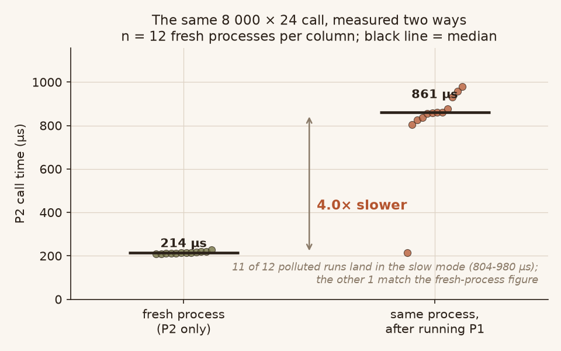
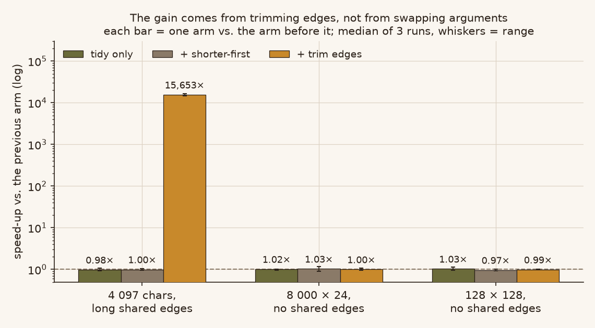
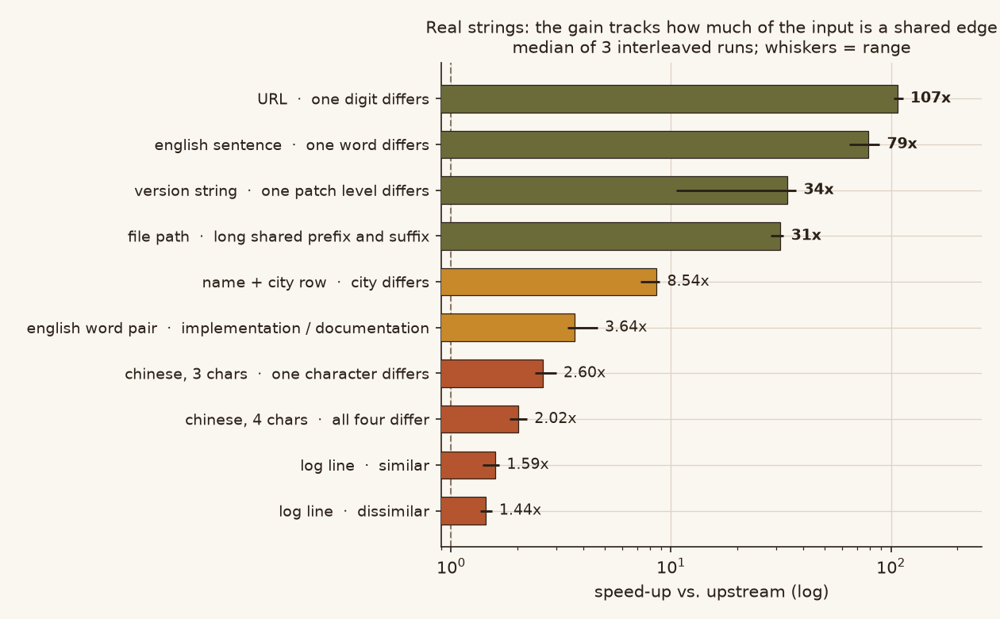
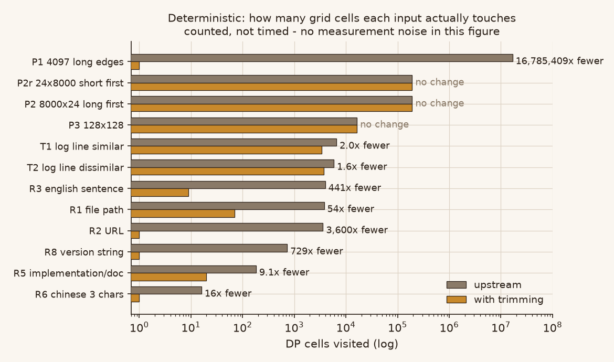
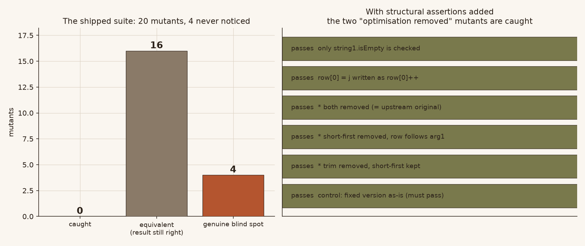

# levenshtein-java-audit

An audit of a third-party "optimisation package" for
[TheAlgorithms/Java](https://github.com/TheAlgorithms/Java)'s
`LevenshteinDistance`, plus a corrected version of the same change.

The package is not wrong. Its algorithm is correct, its memory claim holds, and
it fixes a real inconsistency in upstream. But **two of its three headline
performance numbers are artefacts of how it measured them**, it does not pass
upstream CI, and its test suite cannot tell whether the optimisation is still
there. This repo contains the probes that establish each of those claims, and a
patched version that passes upstream's own checks.

```
what the package claims        what a clean measurement shows
0.66x on 8 000 x 24            1.00x   (its 0.66x was cross-case pollution)
0.81x on 128 x 128             0.99x   (same cause)
134x on 4 097-char edges       15 000x (it under-reported by two orders)
```

## The finding that matters most



The package's benchmark runs three cases in one JVM, in sequence:
4 097-char strings with long shared edges, then 8 000 x 24, then 128 x 128. It
reports the second and third as **slower** than the original.

They are not slower. Run the second case in a **fresh process** and the same
function takes 209-229 µs across twelve runs. Run it after the first case in the
**same** process and eleven of twelve runs take 804-980 µs — a 3.8x to 4.6x
swing with no change to the code being measured.

The twelfth run is unaffected, and that is worth being precise about: the defect
is not "P1 always slows P2 by 4x", it is "the result is a coin flip between
215 µs and 860 µs, and a benchmark that runs each case once cannot tell which it
got." The package happened to draw the slow side.

The cause is not allocation or GC (GC count is zero throughout). It is the C2
compiler's branch profile: the first case drives the trimming path through
thousands of iterations where the prefix scan consumes almost the whole string,
so C2 compiles that path with a profile that never sees a mixed input. The
second case then trips an uncommon trap, deoptimises, and recompiles into a
worse shape. Measured with `-XX:TieredStopAtLevel=1` (C1 only) the two columns
are identical, which pins it to C2.

**This does not heal.** Ten consecutive batches of the second case, 600 calls,
still sit at 790 µs. It only disappears when the two cases are *interleaved* —
mixed traffic keeps both profiles alive and the second case stays at 211 µs.

So this is a benchmark-methodology defect, not a defect in the algorithm. It is
worth recording because the same pattern will silently corrupt any multi-case
Java microbenchmark that runs a long input before a short one.

## Where the speed-up actually comes from



The package makes two changes and describes them as peers. Split into adjacent
arms — each bar is one arm against the arm immediately before it — only one of
them does anything for time:

| arm | change | 4 097-char edges | 8 000 x 24 | 128 x 128 |
|---|---|---|---|---|
| A -> A2 | tidy the code, no algorithm change | 0.98x | 1.03x | 1.02x |
| A2 -> B | + shorter-first dispatch | 1.00x | 1.03x | 0.97x |
| A2 -> C | + trim shared edges | **15 653x** | 1.00x | 0.99x |

The shorter-first swap is a **memory** optimisation. Its time effect is zero,
within noise, in both argument orders. That is a legitimate result — upstream's
Javadoc claims it already does this while the code does not — but the package's
`PATCH_NOTES.md` lists it as one of "two targeted changes" without saying that
one of them buys no speed.

## The headline number is real but conditional



All three of the package's cases are hand-built: `'a' * n` versus `'b' * n`, or
`'p' * 2048 + "X"` versus `'p' * 2048 + "Y"`. None resembles a workload anyone
has.

Measured on real strings instead, the gain is entirely a function of **how much
of the input is a shared edge** — not of string length:

| input | speed-up |
|---|---|
| URL, one digit differs | 107x |
| English sentence, one word differs | 79x |
| version string, one patch level differs | 34x |
| file path, shared prefix and suffix | 31x |
| name + city row, city differs | 8.5x |
| `implementation` / `documentation` | 3.6x |
| Chinese, 3 chars, one differs | 2.6x |
| Chinese, 4 chars, all differ | 2.0x |
| **log line, similar** | **1.59x** |
| **log line, dissimilar** | **1.44x** |
| 128 x 128, no shared edges (control) | 1.01x |

The two log lines share only `2026-10-17 23:0` — seventeen characters — before
they diverge. That is what real log-deduplication input looks like, and it gets
**1.5x, not 100x**. Anyone reading "134x" as a general figure will be
disappointed by a factor of a hundred on their own data.

## Deterministic view: grid cells



Timing figures carry noise; this one does not. It counts DP cells, which is a
property of the algorithm alone.

The two asymmetric cases are worth noting: trimming changes nothing there
(192 000 cells either way) while the row shrinks from 8 001 ints to 25. That is
the memory win, isolated from any timing question.

## The test suite cannot see the optimisation



Twenty mutants were built and fed to the package's own test logic. Nine were
caught. Seven were not caught but are *equivalent* — the result is still
correct, so a behavioural test could never catch them, and that is fine.

Four are genuine blind spots, and two of them are structural:

- **trim removed entirely, shorter-first kept** — result correct, suite green.
- **trim kept, shorter-first removed** — result correct, suite green.

Both of these delete the optimisation itself. Every assertion in the shipped
suite is `assertEquals(expected, actual)`, and trimming and swapping are
semantics-preserving, so removing them changes no return value. No behavioural
test can distinguish a working optimisation from a deleted one.

The other two blind spots are outright wrong answers that happened to fall
outside the suite's coverage: checking only `length1 == 0` and not
`length2 == 0`, and writing `row[0] = j` as `row[0]++`.

## What upstream CI says

The package ships no `pom.xml`; it is a `javac`-and-run extraction. Checked
against the real repository (Maven 3.9.11, JDK 21, checkstyle 14.3.0, the
project's own `checkstyle.xml`), the shipped file fails:

```
[ERROR] LevenshteinDistance.java:61:9: 'if' construct must use '{}'s. [NeedBraces]
[ERROR] LevenshteinDistance.java:62:9: 'if' construct must use '{}'s. [NeedBraces]
[ERROR] LevenshteinDistance.java:73:9: 'for' construct must use '{}'s. [NeedBraces]
[INFO] BUILD FAILURE
```

`if (length1 == 0) return length2;` is the culprit. The upstream ruleset sets
`NeedBraces` at `severity=error`. A pull request carrying this file would be
rejected before any test ran.

`javac --release 21 -Xlint:all -Werror` and the 26 existing upstream tests do
pass — but that suite is 13 short-string cases run against two methods, and it
would pass on almost anything.

## What is correct in the package

Three things, and they are worth stating plainly:

1. **The overlap guard is right.** `end1 > start1 && end2 > start2` stops the
   suffix scan from crossing into the trimmed prefix. Inputs that break naive
   implementations — `"aaa"` vs `"aa"`, `"abab"` vs `"ab"`, `"abcabc"` vs
   `"abc"` — all return correct distances and none throw.
2. **It fixes a real upstream inconsistency.** Upstream's Javadoc says the
   method "minimizes space usage by leveraging the shortest string
   horizontally", but the code allocates `string1.length() + 1` unconditionally.
   The package makes the doc true.
3. **Interface contract is unchanged.** Twenty edge cases compared against
   upstream — null arguments, surrogate pairs, lone high surrogates, NUL, an
   80 000-character identical pair, overlapping prefix/suffix — all agree.

## The corrected version

`src/main/java/.../LevenshteinDistance.java` is the same change with three
repairs:

- **braces on every `if` and `for`** so upstream's checkstyle passes;
- **`unmatchedRanges()`, `rowString()` and `rollingRowLength()` extracted as
  package-private methods** so the tests can assert the optimisation is present
  structurally, not just that the answer is right;
- **`string2.isEmpty()` early return added** (upstream's Javadoc promises
  shortest-first, and the shipped version only guards `string1`).

It passes, on the real upstream repository:

```
checkstyle (14.3.0, upstream ruleset)   0 violations, BUILD SUCCESS
javac --release 21 -Xlint:all -Werror   exit 0
upstream tests + new structural tests   43 tests, 0 failures
mutants re-fed to the new suite         both "optimisation removed" mutants caught
```

Performance is unchanged from the package: 15 900x on the 4 097-char edge case,
92x on the English sentence, 1.74x on the log line, 1.00x on the asymmetric and
dissimilar cases.

## Running it

```bash
# probes (no dependencies beyond a JDK 21+)
javac -encoding UTF-8 -d classes audit/*.java

java -cp classes audit.Cells       # deterministic DP cell counts
java -cp classes audit.Contract    # 20-case interface contract comparison
java -cp classes audit.Poison      # 20 mutants against the shipped test logic
java -cp classes audit.Poison2     # 12 mutants against the corrected suite
java -cp classes audit.Pollute2 clean     # 8 000 x 24 in a fresh process
java -cp classes audit.Pollute2 p1-opt    # ... and after the long-edge case
java -cp classes audit.Two R2 P Q         # one case, two arms, interleaved

# regenerate every number and figure
python run_bench.py
python assets/make_figures.py
```

`run_bench.py` spawns a fresh JVM per measurement — that is the whole point.
`assets/make_figures.py` reads `data/bench.json` and writes `assets/*.png`; no
number in a figure is typed by hand.

## Layout

```
audit/          probes: arms, mutants, contract, cell counts, pollution
src/            the corrected LevenshteinDistance and its test class
data/bench.json every number used by the figures
assets/         five figures + the script that draws them
```

## Scope and provenance

This is an independent audit of a third-party archive supplied for review. It is
not an upstream pull request, not endorsed by TheAlgorithms, and not a full
checkout of their repository. `src/main/java/.../LevenshteinDistance.java` is
derived from upstream `TheAlgorithms/Java`; `LICENSE` is upstream's MIT notice,
byte-for-byte.

Upstream: <https://github.com/TheAlgorithms/Java> — MIT.
